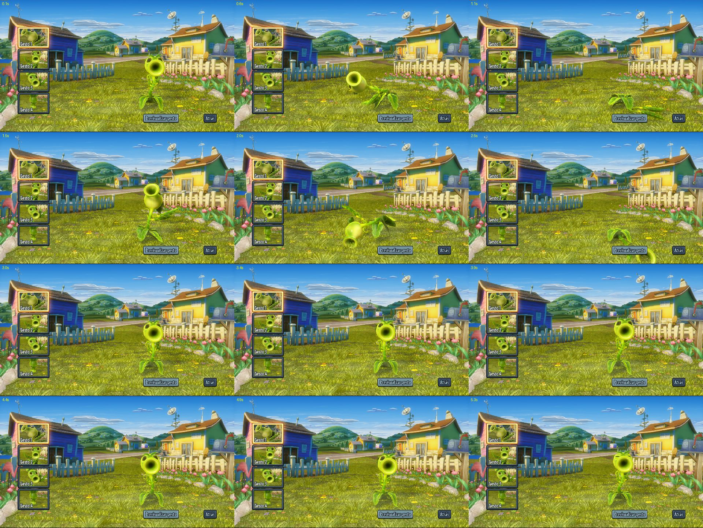

# Animation Editor para Frosty 1.0.7 con importación en PvZ Garden Warfare 1

Modificación **no oficial** del plugin *Animation Editor* (AssetBankPlugin 2.0.1.0) de
**Lala & Obesedwarf** para poder importar animaciones en *Plants vs. Zombies Garden Warfare 1*,
más dos correcciones al fork 1.0.7 de Frosty Editor sin las cuales GW1 no carga ningún mod
lanzado desde él. Todo el mérito del plugin es de sus autores; el código fuente incluido sale de
descompilar su DLL y solo añade lo necesario para GW1.

Sin relación con EA, PopCap ni con los autores de Frosty. No incluye archivos del juego.

## Estado

Probado con Frosty Editor **1.0.7.0 — Virjoinga's Fork 2026.07.28** y GW1 de PC (EA app):

- `.cast` exportado → Blender (io_scene_cast) → FBX → importar: la animación vuelve idéntica.
- El gesto «Baile feliz» del Lanzaguisantes reproduce en el juego la animación importada
  (menú de personalización). **No está probado dentro de una partida.**
- «Import Animation In All Banks» escribe las 10 copias del gesto (menú y niveles) sin fallos.

## Instalar

    instalar.cmd "C:\ruta\a\Frosty"

Con Frosty cerrado. Copia tres archivos y guarda los originales como `*.original`:

| Archivo | Qué es |
|---|---|
| `Plugins\AssetBankPlugin.dll` | el plugin con importación para GW1 |
| `FrostyModSupport.dll` | corregido: el mod de GW1 se escribe en `Update\Patch\Data` |
| `FrostySdk.dll` | corregido: los `.toc` de GW1 llevan cabecera `00 D1 CE 03` |

Los dos DLL de Frosty son **solo para esa compilación del fork**. Para otra, genera los tuyos con
`herramientas\parchear_fms.ps1` y `herramientas\parchear_sdk.ps1` (usan el Mono.Cecil que trae
Visual Studio; no cambian nada si GW1 ya está en las listas).

Para deshacer: `instalar.cmd "C:\ruta\a\Frosty" restaurar`

## Usar

1. Abre en Frosty el `..._win32_antstate` que contiene la animación.
2. Clic derecho sobre el `VbrAnimationAsset`:
   - **Import Animation** → FBX → **Save**: cambia solo el banco abierto.
   - **Import Animation In All Banks** → FBX: la escribe en todos los bancos que la tienen
     (el del menú y el de cada nivel). No hace falta Save.
3. **Launch**.

Con la EA app el juego se relanza sin argumentos y pierde `-dataPath`: la carpeta del mod le
llega por la variable de entorno `GAME_DATA_DIR`, por ejemplo con FrostyFix y el perfil *Editor*.

### Desde Blender

Exporta el `.cast` desde Frosty, carga en Blender el FBX de malla del personaje (trae la
armadura), selecciona la armadura, importa el `.cast`, edita y exporta **FBX**. No hay que tocar
escala ni ejes. `herramientas\cast_a_fbx.py` hace lo mismo sin interfaz.

### Límites

- Solo se importa sobre un `VbrAnimationAsset` existente; duplicar assets o editar propiedades no
  está soportado en GW1.
- **FBX o DAE**: el Assimp del plugin no lee animaciones de glTF ni `.cast`.
- Los huesos se emparejan por nombre; los que el archivo no anima conservan la pose original.
- Si la animación dura distinto que la original, la duración del clip solo se ajusta cuando el
  clip está en el mismo banco. En `gamelogic_shared` y `rush` conviene mantener los fotogramas.

## Qué arreglan los dos DLL de Frosty

El fork quitó GW1 (`DataVersion` 20140225) de listas donde la 1.0.6.3 sí lo tiene:

1. `FrostyModExecutor.Run` escribía el mod en `ModData\<pack>\Patch`; el juego busca en
   `<dataPath>\Update\Patch\Data`.
2. `DbWriter.Write` ponía a los `.toc` la cabecera firmada `00 D1 CE 01`; el juego se cerraba a
   los 2 segundos de arrancar, sin mensaje.

Si Frosty se cierra al pulsar Launch con `NullReferenceException` en `IsSamePatch`, borra
`layout.toc` y `mods.json` de `ModData\Editor\Update\Patch\Data` y vuelve a lanzar.

## Compilar

`fuente\compilar.cmd`, con el `csc` de Visual Studio. Cambia antes `C:\Frosty` por tu carpeta de
Frosty en `fuente\compilar.rsp` y `fuente\pruebas\*.rsp`.

| Carpeta | Contenido |
|---|---|
| `instalar\` | lo compilado, listo para copiar |
| `fuente\AssetBankPlugin\` | fuente del plugin; lo nuevo está en `AssetBankPlugin.Import\` y `AssetBankPlugin.Import.Gw\` |
| `fuente\res\` | recursos WPF del plugin original, sin cambios |
| `fuente\pruebas\` | pruebas sin Frosty contra bancos reales (hay que extraerlos del juego) |
| `herramientas\` | parches de Frosty, inspección de bancos y `.sb`, automatización |
